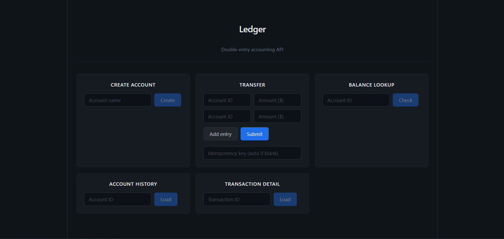

# haskell-ledger

A minimal double-entry ledger service in Haskell, backed by Postgres and exposed over HTTP. The headline invariant is that money is conserved: the sum of signed entries in every transaction equals zero, and that rule is enforced in two places that reinforce each other. A smart constructor on the `Transaction` type rejects any entry list that does not sum to zero, so unbalanced transactions cannot exist as values in the program. Every write then happens inside a single Postgres transaction, so a crash mid-write cannot leave half a transfer on disk. Property tests over hundreds of randomized transfers assert both of these invariants on every run.

## Live demo

> **Note:** The frontend is a thin UI for exercising the API — the Haskell backend is the focus of this project.

[](https://haskell-ledger.vercel.app/)

**[Try it live →](https://haskell-ledger.vercel.app/)**

The demo talks to the same Haskell service described below. Here are some things to try:

1. **Create two accounts** — e.g. "alice" and "bob". Note the account IDs returned.
2. **Make a transfer** — enter entries that sum to zero: debit one account and credit the other. For example, move $5.00 from alice (account 1) to bob (account 2) with entries `[{"account":1,"amount":-500},{"account":2,"amount":500}]` and any idempotency key like `"demo-1"`.
3. **Check balances** — look up each account's balance and confirm the amounts mirror each other.
4. **View history** — pull up an account's transaction history to see every entry.
5. **Try an unbalanced transfer** — enter amounts that don't sum to zero (e.g. `-500` and `300`) and watch the API reject it. This is the smart constructor at work.
6. **Replay with the same idempotency key** — submit the same transfer again with `"demo-1"` and confirm you get the original transaction back, not a duplicate.

## Design choices

**Money as a newtype over integer cents.** `Money` is a `newtype` wrapping `Int`, not a `Double` and not a bare `Int`. Floats are off the table for anything financial, since rounding errors accumulate silently. The newtype also keeps account ids and amounts from being accidentally interchanged at a call site, which is a mistake the compiler cannot catch when both are `Int`. Newtype deriving pulls `FromField`, `ToField`, `FromJSON`, and `ToJSON` through for free, so the type is strict in Haskell but transparent at the DB and JSON boundaries.

**Transaction with a hidden constructor.** `Ledger.Types` exports the `Transaction` type but not its data constructor. The only way to produce a `Transaction` value is through `mkTransaction`, which returns `Either LedgerError Transaction` and rejects the empty list and any non-zero sum. If a function anywhere in the program has a `Transaction` in hand, it is already balanced. There is no "did someone remember to validate it" question downstream.

**Raw SQL over an ORM.** The persistence layer is a thin wrapper over `postgresql-simple` with hand-written `INSERT` and `SELECT` statements. For a ledger, the exact wire-level shape of each write matters, and transaction boundaries have to be explicit. An ORM would hide both. The queries are short enough to read in one pass.

**Scotty over Servant.** Scotty was picked for weight. The whole HTTP layer is one short module with one handler per endpoint. Servant's type-level DSL would buy static route safety and generated clients, but at the cost of more concepts for a reader to hold at once. For a service with five routes and no plan to generate clients, Scotty is a better fit. A production rewrite would use Servant.

**Idempotency via a unique constraint, not application logic.** `transactions.idempotency_key` has a `UNIQUE` constraint. When a replay arrives with the same key, the `INSERT` fails with a unique-violation, which `insertTransaction` catches and translates into "look up the original tx id and return it." The database is the source of truth about whether this key has been seen. Idempotency is not an HTTP header, it is a field in the JSON body; see scope cuts.

**Balances are derived, not stored.** `fetchBalance` is a `SUM(amount_cents)` query. There is no cached balance column anywhere. Stored balances would need to stay in sync with entries, which is a well-known source of ledger bugs, and if they ever drift the only honest fix is a reconciliation pass that recomputes from entries anyway. A production system would eventually materialize balances for read performance, but it would do that as a cache on top of the derived view, not as the source of truth.

## Numbers

- 749 lines of Haskell across `src/`, `app/`, and `test/` (189 `Ledger.Db`, 158 `Ledger.Http`, 123 `Ledger.Types`, 7 `app/Main.hs`, 141 `test/Integration.hs`, 130 `test/Main.hs`; one line trimmed from `Http.hs` after the handoff count).
- 5 REST endpoints: `POST /accounts`, `POST /transfers`, `GET /accounts/:id/balance`, `GET /accounts/:id/history`, `GET /transactions/:id`.
- 5 Hedgehog property tests: 3 pure (`prop_balanced_succeeds`, `prop_unbalanced_fails`, `prop_roundtrip_sums_zero` over the smart constructor), 2 integration against a live Postgres (`prop_conservation`, `prop_idempotent`).
- 100 randomized cases per property per run, 500 cases total each `cabal test` invocation.

## Scope cuts

Known omissions. Each has an obvious production fix.

- **No pagination on `/accounts/:id/history`.** The handler returns every entry touching the account. Production fix: cursor-based pagination on `entries.id`, newest first, with a `limit` query parameter.
- **No auth.** Any client can create accounts and post transfers. Production fix: an auth middleware in front of every route, with the acting user id threaded through to handlers.
- **No connection pool.** One `Connection` is opened at startup and shared across every request, which serializes requests at the DB layer. Production fix: `resource-pool` around `openConnection`, with each handler checking out and returning a connection.
- **Idempotency key in the JSON body, not an `Idempotency-Key` header.** Easier to parse without introducing a header type, but off-standard. Production fix: read the header, fall back to body for compatibility if needed.
- **Scotty, not Servant.** No compile-time route or body-shape guarantees. Production fix: port the five handlers to a Servant API type and remove the hand-written JSON instances in favor of the derived ones Servant threads through.

## How to run

Requires GHC 9.10, Cabal 3.14, and a running Postgres instance.

Set up the database:

```bash
# as the postgres superuser
createdb ledger
psql -U postgres -d ledger -f schema.sql
```

Create a `.env` file in the project root with your DB credentials:

```
LEDGER_DB_HOST=localhost
LEDGER_DB_PORT=5432
LEDGER_DB_USER=postgres
LEDGER_DB_PASSWORD=yourpassword
LEDGER_DB_NAME=ledger
```

Build and test:

```bash
cabal build
cabal test
```

Boot the server on port 3000:

```bash
cabal run
```

Hit an endpoint:

```bash
curl -s -X POST http://localhost:3000/accounts \
  -H "Content-Type: application/json" \
  -d '{"name":"alice"}'

curl -s -X POST http://localhost:3000/transfers \
  -H "Content-Type: application/json" \
  -d '{"entries":[{"account":1,"amount":-500},{"account":2,"amount":500}],"idempotency_key":"demo-1"}'

curl -s http://localhost:3000/accounts/1/balance
```
